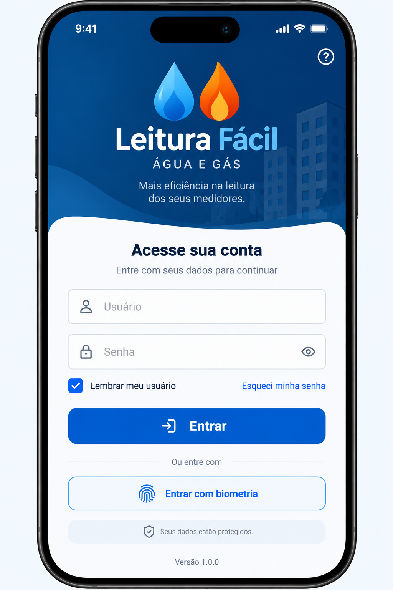

# Leitura Fácil

Aplicativo móvel destinado à coleta, conferência e sincronização de leituras de medidores de água e gás em condomínios.
Priorizar confiabilidade dos dados, operação em campo, acessibilidade, desempenho, simplicidade da interface e rastreabilidade das alterações.
Aplicação assistida por IA codex SSD

## Prototipos Telas

<p align="center">
  
  &nbsp;&nbsp;&nbsp;
  
  &nbsp;&nbsp;&nbsp;
  
  &nbsp;&nbsp;&nbsp;
  
  &nbsp;&nbsp;&nbsp;
  
</p>

## Tecnologia

- React Native
- Expo
- SQL Lite
- AWS

## Executar

Requisitos: Node.js 24 LTS e npm. Após clonar, execute `npm ci`.

```powershell
npm start
npm run android
npm run web
```

Use dispositivo Android ou emulador para validar SQLite. Compilação local iOS exige macOS. A rota web verifica somente a interface; SQLite web ainda não está habilitado.

```powershell
npm run typecheck
npm run lint
npm test
npm run format:check
npx expo install --check
npx expo-doctor
```

## Estrutura

- `app/`: layout Expo Router e rota de verificação.
- `src/theme/`: tokens e Inter.
- `src/database/`: SQLite e migrações versionadas, sem tabelas de negócio.
- `src/stores/`: sessão não configurada, sem tokens ou autenticação.
- `src/api/`: configuração pública opcional, sem HTTP.
- `assets/`: imagens provisórias do template oficial.
- `tests/`: configuração API e proteção de versão do banco.
- `specs/`: registro BOOT-001 e ADR.
- `prompts/` e `AGENTS.md`: documentos originais preservados.

Pastas das próximas funcionalidades serão criadas quando houver conteúdo real.

## Configuração pública

Copie `.env.example` para `.env.local` se necessário. `EXPO_PUBLIC_API_URL` pode ficar vazia; não há integração de rede habilitada. Valores `EXPO_PUBLIC_*` entram no aplicativo: nunca incluir credenciais, senhas ou tokens.

Material Symbols está disponível por `expo-symbols` do SDK em Android/web; iOS usa SF Symbols. O mapeamento uniforme baseado no Figma fica para DS-001 antes da criação dos componentes de ícones.

Não foram implementadas telas de Login/Home, autenticação, AWS ou regras de negócio.
